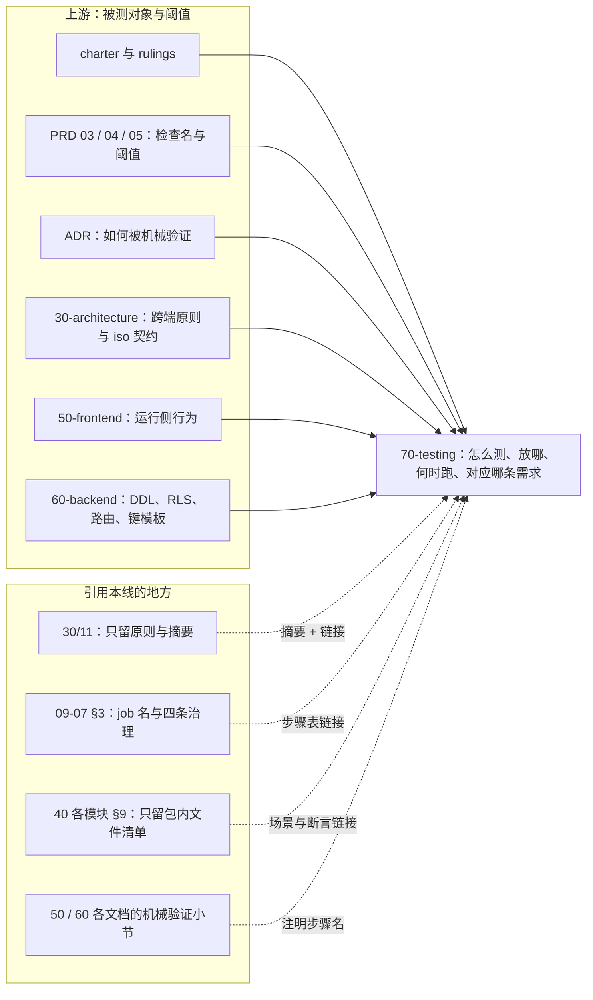
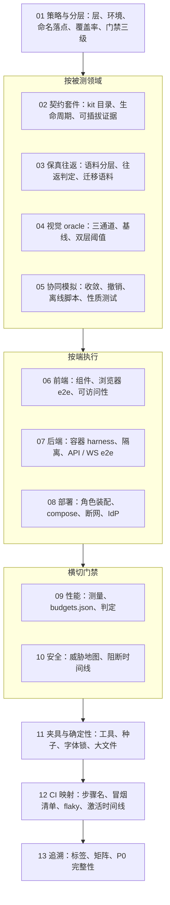

# 70 测试设计线：定位、边界与导航
> 状态：v0.1 | 负责：测试设计线 | 更新：2026-09-25；2026-09-25（§4.19）；2026-09-25（§4.19 N1） | 依赖：charter v0.2、rulings §4.11–§4.19、[docs/README.md](../README.md)、[30-architecture/11](../30-architecture/11-testing-strategy.md)、[09-type-discipline/07](../30-architecture/09-type-discipline/07-hooks-and-ci.md)、[40-modules/_template.md](../40-modules/_template.md)

## 1. 定位

`70-testing/` 是测试侧的唯一事实源，回答五个问题：**测什么**（以哪条需求、裁决或契约为被测对象）、**放在哪里**（文件后缀与目录）、**用什么工具**、**阈值怎么判**、**在 13 个 CI job 的哪个步骤运行**，并维护「需求 → 测试」的追溯矩阵。

- 被测对象的定义不在本线：跨端契约与协议在 30-architecture，前端运行侧行为在 [50-frontend](../50-frontend/README.md)，后端表结构、RLS、路由与键模板在 [60-backend](../60-backend/README.md)。50 / 60 每份文档末的「机械验证」小节写「断言什么」并注明本线的步骤名，本线写「怎么断言、放哪、何时跑」。
- 数字（PRD NF 的 gate、体积预算、协同阈值）只引用不复制：gate 取 PRD 04，前端 target 取 [50/13](../50-frontend/13-performance-and-bundling.md)，服务端 target 取 [60/01](../60-backend/01-service-overview-and-roles.md)；本线定义测量方法与判定规则。
- 30/11 只保留跨端测试原则（金字塔、不 mock 内核只 mock IO、确定性、契约即验收、阈值只收紧）与 Univer 对照表，其余章节由总编排改为「摘要 + 链接」指向本线（§8）。

---

## 2. 本线拥有 / 本线引用

三条设计线（50 / 60 / 70）的总边界表在 [docs/README.md](../README.md)（由总编排回写，§8），本节只列本线自己的两张表。

**本线拥有**：

| 事项 | 文件 |
|---|---|
| 测试分层与运行环境、文件命名与落点（T-NAMING）、根 `test/` 布局、iso 冒烟、类型测试、覆盖率、门禁三级、所有权矩阵 | [01](./01-strategy-and-layers.md) |
| 契约套件目录、kit 统一接口、用例 id 与运行矩阵、生命周期套件、可插拔与文档类型盲证据 | [02](./02-contract-suites-and-pluggability.md) |
| 语料分层与清单 schema、零编辑与编辑后往返判定、导出确定性、快照迁移语料 | [03](./03-fidelity-roundtrip-and-corpus.md) |
| 视觉 oracle 三通道、基线生成、双层阈值、capabilities | [04](./04-visual-oracle.md) |
| 协同模拟、fuzz、性质测试、确定性协同与离线脚本 | [05](./05-collab-simulation-and-property-tests.md) |
| 前端组件测试、浏览器 e2e、可访问性执行口径 | [06](./06-frontend-component-and-e2e.md) |
| 后端集成、容器 harness、数据库隔离、API / WS e2e | [07](./07-backend-integration-and-api-e2e.md) |
| 部署拓扑与环境 e2e、IdP 兼容矩阵、发布与备份演练 | [08](./08-deployment-and-environment-e2e.md) |
| 性能与容量的测量方法、`test/perf/budgets.json` 结构、门禁判定 | [09](./09-performance-and-capacity.md) |
| 威胁 → 测试 → 执行点总表、安全用例的阻断时间线 | [10](./10-security-testing.md) |
| 夹具、确定性工具、服务端种子、IdP 夹具、字体锁、大文件存储 | [11](./11-test-data-fixtures-and-determinism.md) |
| CI 步骤名定稿、三段触发、PR 冒烟清单、flaky 策略、里程碑激活时间线 | [12](./12-ci-gates-mapping.md) |
| 追溯标签、`requirements.json`、检查名目录、P0 完整性判定 | [13](./13-requirements-traceability.md) |

**本线引用**（不拥有，冲突以右列事实源为准）：

| 事项 | 事实源 | 本线怎么用 |
|---|---|---|
| 金字塔、只 mock IO、确定性、契约即验收、阈值只收紧 | [30/11](../30-architecture/11-testing-strategy.md) 保留的原则段 | 01 §1 引用 |
| 13 个 CI job 名封闭集合与四条治理（存在、PR 触发、error 阻断、不可跳过） | [09-07 §3](../30-architecture/09-type-discipline/07-hooks-and-ci.md#3-ci-工作流矩阵) | 12 只定义 job 内的步骤 |
| 扫描器定义与「14 个」上限 | [09-06](../30-architecture/09-type-discipline/06-scanners.md)、09-08 §11 | 只作执行点引用，不新增扫描器 |
| iso 契约本体（DocumentStore、StoreOp、中性撤销、TextMeasurer、RenderTarget、OfflineStore） | 30 正文与已接受 ADR | 02 kit 的断言对象 |
| WS 帧、CONTROL、ack、关闭码 | 30/06 §6 | 05、07 的断言对象 |
| 前端运行侧行为（Session FSM、/render ready 判据、CSP 正文、错误文案） | 50-frontend | 06、10 的断言对象 |
| DDL、RLS 测试矩阵、迁移编号、Valkey 键模板、对象键、REST 路由表、配置 schema | 60-backend | 07、08、10、11 的断言对象与种子依据 |
| 验收检查名、验收阈值、NF gate 数值 | PRD 03 / 04 / 05 | 09、12、13 |
| 包内测试文件清单 | 40-modules 各 §9 | 01 §5 对账 |

**图 R-1 测试设计线与上下游的边界**

怎么读：实线从左侧上游指向本线，表示本线以它们为被测对象或阈值来源；右侧虚线从引用方指向本线，标签是引用方式——这些文档不再复述测试细则，只留摘要并链接到 70。

依据：计划 ownership「口径链」与「机械验证分工」两条；rulings §4.18 GV-14。

---

## 3. 文件地图与阅读顺序

建议顺序：01 → 02 / 03 / 04 / 05 → 06 / 07 / 08 → 09 / 10 → 11 → 12 → 13。先读 01 建立分层与落点，再按被测领域读契约、保真、oracle、协同，然后按端读前端、后端、部署，接着读横切的性能与安全，最后读夹具、CI 映射与追溯。

**图 R-2 本线文件阅读路径**

怎么读：自上而下是推荐阅读顺序；同一分组内的文件互不依赖，可按需挑读；11–13 是支撑性文档，写新测试前查 11，排查 CI 失败查 12，出口评审查 13。

---

## 4. 术语

| 术语 | 含义 |
|---|---|
| gated（阻断） | 检查失败即 job 失败、阻断合并；只能收紧，降级须走带 issue 与到期日的临时例外（[01 §10](./01-strategy-and-layers.md#10-门禁三级)） |
| 报告 | job 通过，同时产出产物（HTML、JSON、差异图）或 PR 注释；不存在 warn 级别（决策 T-PERF-GATE） |
| 人工 / 半机械 | 证据归档在 `test/evidence/<里程碑>/<检查名>.md`，追溯矩阵标 `manual` 并单独统计 |
| kit（契约套件） | Definition 所在包从 `./testing` 导出的 `run<Definition>Conformance(factory, options)`，Provider 的验收（[02](./02-contract-suites-and-pluggability.md)） |
| PR 冒烟子集 | `e2e/smoke` 步骤在每个 PR 上运行的固定用例集，清单在 [12 §4](./12-ci-gates-mapping.md) |
| main 全量段 | 合入 main 后才运行的 e2e 全量、compose 与断网 e2e、性能全量 |
| nightly 套件 | schedule 触发同一工作流、`CORDEX_SUITE=nightly`，复用 13 个 job 名，只放大规模（协同模拟万轮、oracle 全量、T1+T2 全量语料、Keycloak） |
| 包络 / 天花板 | 性能保证包络（门禁只收紧）与系统天花板（只监测、超出拒绝导入），rulings §4.15 Q5 |
| gate / target | gate 取 PRD 值，超出即失败；target 取 50/13、60/01 的更严值，超出只报告 |
| oracle | 以 PowerPoint 输出为基线的视觉与结构比对（[04](./04-visual-oracle.md)） |
| repro 种子 | 随机测试失败时记录的种子与最小化后的显式操作序列，入库成为确定性回归用例 |
| T1 / T2 / T3 语料 | 规范语料（入 git）/ 真实语料 / 压力语料（后两者只登记清单、文件在对象存储），决策 T-CORPUS |
| 人物与 `fixtureId` | 服务端基础种子里的固定用户与固定 UUID（[11 §6](./11-test-data-fixtures-and-determinism.md#6-服务端种子构建器)） |
| PRD 检查名 / CI 步骤名 | PRD 里的验收检查名（如 `fidelity:roundtrip`、`security:rls`）是需求侧名字；CI 步骤名（如 `test/fidelity-roundtrip`、`e2e/smoke`）是执行侧名字；二者映射在 [12 §6](./12-ci-gates-mapping.md) 与 [13 §3](./13-requirements-traceability.md) |

---

## 5. 引用规则

- 其它线引用本线写相对链接加小节号，形如「[70-testing/05 §9](./05-collab-simulation-and-property-tests.md)」；不复制本线的表格与阈值。
- 50 / 60 的「机械验证」小节每行写三样东西：断言（what）、本线的 CI 步骤名（`job/步骤`）、测试文件落点（后缀与目录按 [01 §4](./01-strategy-and-layers.md#4-文件命名与落点t-naming)）。
- 测试文件与用例的追溯标签按 [13 §1](./13-requirements-traceability.md)：`@req PRD:<id>`、`@ruling <节>/<id>`、`@adr <编号>/<决策号>`（决策 T-REQ）。
- 写「扫描器 + 名字」时，名字必须能在 09-06 或 09-08 §11 查到（`docs/_tools/check-scanner-names.py`）；本线不新增扫描器与 CI job。

**CI 步骤工作名**（以 [12 §2](./12-ci-gates-mapping.md) 为定稿，其余文件引用时用这些名字）：

| job | 步骤 |
|---|---|
| `test` | `unit`、`contract`、`lifecycle`、`fidelity-roundtrip`、`collab-sim`、`snapshot-migration-corpus`、`preset-blind`、`server-integration`、`requirement-matrix` |
| `test-typecheck` | 单一步骤 |
| `iso-smoke` | 单一步骤 |
| `e2e` | `smoke`（内含 `security-rls`、`renderer-egress`、`login-oidc-mock`、`login-casdoor`）、`oracle-gated`、`a11y`、`full-compose`、`full-airgap` |
| `perf` | `perf-client`、`perf-collab`、`perf-server` |
| `scanners` | `lockfile-guard`（全量模式，先行）、`scan-*`、`check-*`、`license-allowlist`、`vuln-audit`、`scan-manifest --check`、`schema-lock`、`shadcn-diff`、`horizontal-freeze` |
| `api-surface` | `api-surface`（主步骤）、`docs-coverage`（M4）、`scaffold-e2e`（M4） |
| `lint`、`typecheck`、`depcruise`、`policy-check`、`xsd-validate`、`coverage-patch` | 单一步骤 |

nightly 以 `CORDEX_SUITE=nightly` 复用同名 job（决策 T-CI）。

---

## 6. 待决项的处理结果

**30/11 §14 T1–T4 的处理结果**：

| # | 事项 | 结果 | 依据 |
|---|---|---|---|
| T1 | 大基线与样本的存储 | 已定：对象存储 + sha256 清单，不用 Git LFS；≤ 2 MB 的 T1 样本入 git（[11 §10](./11-test-data-fixtures-and-determinism.md#10-大文件t-corpus)） | 决策 T-CORPUS（needsUser=false） |
| T2 | 性能 runner | 已定：M1 GitHub larger runner（4 核）；自托管专用 runner M2 前落地，承载 gated 协同与 RM-S 服务端压测；低配以 CDP CPU 4× 节流近似（[09 §9](./09-performance-and-capacity.md)、[12 §8](./12-ci-gates-mapping.md)） | rulings §4.19 D-TEST-INFRA |
| T3 | PowerPoint 基线机器与版本锁定 | 已定：一台 Windows + PowerPoint 365 维护机，不进 CI，脚本生成基线提 PR 评审签字；macOS 基线 M2 加入（[04 §2](./04-visual-oracle.md)） | rulings §4.19 D-TEST-INFRA |
| T4 | e2e 在 PR 上的范围 | 已定：默认 8 条 + `security-rls` + `renderer-egress` + `login-oidc-mock` + `login-casdoor` + `oracle-gated`，分片后 ≤ 15 min（[12 §4](./12-ci-gates-mapping.md)） | 决策 T-CI（needsUser=false） |

D-TEST-INFRA 的原推荐「M3 前落自托管 runner」随 rulings §4.19 D-M2-CONTENT（协同后端提前到 M2）提前为「M2 前」，RM-S 服务端场景自 M2 起。

**本线已定项**（needsUser=false，按推荐写入，段内注明依据）：

| 决策 | 结论摘要 | 落点 |
|---|---|---|
| T-NAMING | `*.type-test.ts`、`*.browser.test.ts`、`*.int-spec.ts`、`*.e2e-spec.ts`、`apps/web/e2e/**/*.spec.ts`、根 `test/<suite>/`；废 `test/e2e`、`test/server-integration` | 01 §4 |
| T-COVERAGE-EVIDENCE | patch 行 ≥ 80%、分支 ≥ 70% 阻断，包级不下降；包级下限只作目标；人工证据归档格式 | 01 §8 |
| T-DETERMINISM | `FixedClock`、`SeededRandom` 归 shared/testing；服务端 `CLOCK` 端口 | 11 §2–§3 |
| T-DB-ISOLATION | 每 worker 迁移 template 库、每测试文件克隆；非属主角色连接；不用事务回滚隔离 | 07 §3、11 §6 |
| T-IDP | PR：oidc-provider mock + Casdoor；nightly：Keycloak；Entra、飞书人工 | 11 §7、08 §7 |
| T-CORPUS | 见上 T1 | 03 §1、11 §10 |
| T-ORACLE | gated 宽 1280 px；单样本类别阈值与矩阵行聚合两层都须通过；1920 只报告 | 04 §2、§6 |
| T-PERF-GATE | PR 超 PRD 绝对 gate 即失败；相对回归 PR 只注释、main / nightly 超 10% 失败；内存 20 次开关增长 ≤ 5% | 09 §10、01 §10 |
| T-BUNDLE | 唯一阻断点 `scanners` 的 `scan-bundle-budget`，其余体积断言为信息性 | 09 §11 |
| T-CI | 见上 T4；服务端集成进 `test/server-integration`；flaky 与 nightly 策略 | 12 |
| T-REQ | 三类标签；P0 完整性由 `test/requirement-matrix` 判定 | 13 §1 |
| T-KITS | SceneProvider 不设 kit；新增 `runPermissionPolicyConformance`；UiRenderer 登记 | 02 §3 |

**rulings §4.19 已裁定、影响本线用例的跨线项**（原「待确认（总编排）」，已按裁决定稿）：

| 决策 | 本线的落实 |
|---|---|
| D-M2-CONTENT（协同后端提前到 M2） | 协同网关、Room、update 持久化与快照、服务端导入相关的测试步骤自 M2 激活：`test/collab-sim`、`test/server-integration` 的协同与导入分节、`perf/perf-collab`、`perf/perf-server` 的 RM-S 场景（[12 §7](./12-ci-gates-mapping.md)）；删去 pptx 内容版本用例，改为快照 bootstrap 与服务端导入用例（[06 §5](./06-frontend-component-and-e2e.md) 第 21、22 行，[07 §8](./07-backend-integration-and-api-e2e.md) D10、§11.2–§11.3）；M2 基线包来自 import 快照（[03 §10](./03-fidelity-roundtrip-and-corpus.md)）；PRD 05 新增的 M2 检查名 `server:import`、`collab:persist`、`collab:gate`、`collab:unsaved` 登记在 [13 §3.3](./13-requirements-traceability.md)；M3 只保留多人协同体验层（在场、评论、权限细化、离线体验、多实例与 PG 故障溢写、保留期清理、换纪元、服务端导出与缩略图等）。逐项边界以 [PRD 05 §0.3](../10-prd/05-milestones-and-scope.md) 为准 |
| INC-09（「未保存到服务器」） | 服务端 `CONTROL.room.persist` 信号（[02 §5.2](./02-contract-suites-and-pluggability.md)、[07 §9](./07-backend-integration-and-api-e2e.md) W5）；客户端判据三分支与分级受众（[05 §9](./05-collab-simulation-and-property-tests.md)、[06 §5](./06-frontend-component-and-e2e.md)）：发起方横幅「未保存到服务器 N 项」，其余协作者状态胶囊弱提示「服务器保存延迟」 |
| C-06（自动快照保留） | `snapshots-retention` 断言（[07 §11.4](./07-backend-integration-and-api-e2e.md)）与边界做法（[11 §3](./11-test-data-fixtures-and-determinism.md#3-假时钟统一规则)）：30 天全量、按 UTC 日稀疏至 `autoSnapshotDailyDays`（默认 365，0 = 永久）、named 上限 200、最新 import 快照不删 |
| D-COMMENTS-PKG（新增 `@cordexjs/comments`） | `pluggable:m3` 白名单 `{−store-memory, +store-yjs, −collab-core#local-presence, +collab-yjs, +collab-transport-ws, +comments}`（[02 §10](./02-contract-suites-and-pluggability.md)） |
| D-TEST-INFRA | 见上 T2 / T3 |
| N1-IMPORT-OVERWRITE-RESTORE-LOCK（恢复不锁、覆盖导入换纪元，补完阶段用户裁决） | 锁定断言只剩覆盖导入与迁移（[02 §5.2](./02-contract-suites-and-pluggability.md) `lock/room-locked-signal`、[07 §9](./07-backend-integration-and-api-e2e.md) W14）；恢复不加锁（02 `restore/no-lock`、07 W16、[06 §5](./06-frontend-component-and-e2e.md) 第 15 行）；覆盖导入换纪元（02 `epoch/external-epoch-control-closes-4428`、`put/import-bumps-epoch`，07 W17 与 §11.2 J7，[05 §9](./05-collab-simulation-and-property-tests.md) `rs/import-overwrite`，06 §5 第 21 行）；追溯标签 `@ruling 4.19/N1-IMPORT-OVERWRITE-RESTORE-LOCK`（[13 §6.3](./13-requirements-traceability.md)） |

---

## 7. 对章程与上游文档的异议与建议

不擅改上游文档；以下各条由总编排裁决或按 §8 回写。

| # | 对象 | 问题 | 本线的处理或建议 |
|---|---|---|---|
| 1 | 30/11 §0 门禁表与门禁流 ①；PRD 04 NF-09 | 30/11 写「性能 PR 上仅告警」，NF-09 写「PR 超预算 5% 失败」 | 按 T-PERF-GATE：PR 超 PRD 绝对 gate 即失败，相对回归只作注释；建议 NF-09 该行保留数值、判定方式链接 [09 §10](./09-performance-and-capacity.md)，避免两处各写一套判定 |
| 2 | 30/11 §7 | 基线 1920×1080 与 PRD 的 1280 px 口径不一致 | 按 T-ORACLE：gated 用宽 1280 px，1920 只报告 |
| 3 | 30/11 §10 | 「打开 / 关闭 20 次增长 ≤ 10%」宽于 PRD | 按 T-PERF-GATE 取 ≤ 5% |
| 4 | 30/11 §7、§11 | 基线与大样本「LFS 或对象存储」 | 按 T-CORPUS 只用对象存储 |
| 5 | 30/11 §2、§12；40/02 §9 | 类型测试后缀 `*.test-d.ts` 与 ADR-0048 的 `*.type-test.ts` 不一致 | 按 T-NAMING 取 `*.type-test.ts` |
| 6 | 30/11 §17 | `// @req CO-08` 与 rulings §4.18 的 CO- / BE- 编号同形，无法区分来源 | 按 T-REQ 用 `@req PRD:` / `@ruling` / `@adr` 三类标签 |
| 7 | 09-07 §2.3 | 留给运行时线的问题：单测是否进 `pre-push` | 答复：不进，本地用 `pnpm test:changed`（[01 §9](./01-strategy-and-layers.md#9-本地与-ci-分工)） |
| 8 | 40/_template §9 | 示意顶层 `tests/{unit,contract,integration,fixtures}/`，与 30/02 §4.0 的同位约定矛盾（40/02 §12 G-12 已指出） | 模板 §9 改为「包内测试文件清单；场景与断言见 70」 |
| 9 | 09-type-discipline（类型治理线） | lint 确定性规则 TD-097 只作用于 `ooxml-*`，测试代码里的 `Math.random` / `Date.now` 无机械约束 | 建议把作用域扩展到 `**/__tests__/**` 与 `test/**`（`test/perf/**` 豁免）；属既有 lint 规则的作用域调整，不新增扫描器（[11 §12](./11-test-data-fixtures-and-determinism.md#12-机械验证)） |
| 10 | 09-type-discipline §6 | 「每个 Definition 至少一个 `*.type-test.ts`」没有机械核对 | 建议作为 `scan-manifest` 规则 (e) 的子检查（与「Provider 调用 kit」同一次遍历），不新增扫描器 |
| 11 | 60/05（可测性要求） | 房间名额 Lua 脚本若读 Valkey `TIME`，60 s 过期与 15 s 刷新无法确定性测试 | 已由 [60/05 §4.2](../60-backend/05-modules-collab-and-snapshots.md) 采纳（`ARGV` 传入 `nowMs`），无需回写；测试做法见 [11 §3](./11-test-data-fixtures-and-determinism.md#3-假时钟统一规则) |
| 12 | 30/02 §4；40/06 | 同一替身分别叫 `FixedMetricsMeasurer` 与 `FixedWidthMeasurer` | 统一为 `FixedWidthMeasurer` |
| 13 | 计划 T-DETERMINISM 的归属写法 | 把 `createCommandHarness`、`permission-fakes` 归在 kernel/testing | 40/02 §5 的文件表放在 model-core/testing，以 40/02 为准（[11 §2](./11-test-data-fixtures-and-determinism.md#2-确定性工具目录)） |
| 14 | charter §8、§9.1 | 文档树与分工表尚无测试设计线 | 由总编排在索引回写中补齐 |
| 15 | 30/06 §4 目录树、40/05 §4–§5 与 [05 §2.1](./05-collab-simulation-and-property-tests.md) | `createCollabCluster`、`NetworkModel` 在 30/06、40/05 归 `@cordexjs/collab-yjs/testing`；05 §2.1 改放根 `test/collab-sim/`（理由：模拟需同时装 `server-collab` 与 `model-slide`，水平层包的 `testing/` 装不下） | 已定：按决策 T-NAMING 放根 `test/collab-sim/`（01 §5、11 §2 已改）；30/06 §4 与 40/05 的旧写法由回写删除 |

---

## 8. 回写清单

由总编排在全部写作组完成后执行；本线不改其它文档。

**计划 referencePlan 中与本线有关的条目**：

| 被改文档 | 改法 |
|---|---|
| 30/11 §0 | 保留金字塔原则一段；门禁一览表改为链接 [01](./01-strategy-and-layers.md) 与 [12](./12-ci-gates-mapping.md) |
| 30/11 §1 | 保留「不 mock 内核只 mock IO、确定性」原则段；细则链接 [01](./01-strategy-and-layers.md)、[11](./11-test-data-fixtures-and-determinism.md) |
| 30/11 §2、§5、§12 | → 01 |
| 30/11 §3、§4 | → 02 |
| 30/11 §6、§11 | → 03 |
| 30/11 §7 | → 04 |
| 30/11 §8 | → 05 |
| 30/11 §9 | → 09 |
| 30/11 §10 | → 06、07、08、10 |
| 30/11 §14、§16 | → 本 README §6 |
| 30/11 §17 | → 02、12、13 |
| 30/11 §13、§15 | 保留 |
| 30/07 §9 性能预算与测量 | 数值 → 50/13；测量与门禁 → 09 |
| 09-07 §3 | `test` / `e2e` / `perf` 行的「所含步骤」清单改为链接 12，保留 job 名与四条治理 |
| 09-07 §2.3 | 保留，并链接 01 §9 的本地命令 |
| 09-06 §12 | 保留 `scan-requirement-tags` 定义；完整性门禁链接 13 |
| 09-06 §14–§15 | 两个 `budgets.json`（类型 ratchet 与性能预算）加区分说明，性能一侧链接 09 |
| 40/01 §5.9 | CI job 矩阵的步骤清单改为链接 12 |
| 40/_template §9 | 改为「文件清单；场景与断言见 70」 |
| PRD 04 NF-01、NF-09 | 保留 gate 数值；测量与判定链接 09 |
| 40 各模块 §9 | 「覆盖率与性能预算引用 11（30-architecture）」改为引用 [01 §8](./01-strategy-and-layers.md#8-覆盖率与证据归档t-coverage-evidence) 与 [09](./09-performance-and-capacity.md) |
| docs/README.md、30-architecture/README.md、40-modules/README.md、`_tools/gen-docs-site.py` | 登记三条新线并写三线总边界表（本 README §2 引用它） |

**本线新增的回写项**（来自 01 §4 废止表与 11 的登记）：

| 被改文档 | 改法 |
|---|---|
| 40/02 §9 | `augment.test-d.ts` → `augment.type-test.ts`；根 `test/preset-blind.test.ts` → `test/preset-blind/preset-blind.test.ts` |
| 40/02 §4 / §5（shared） | 登记 `Clock`、`Random` 端口与 `testing/{clock,random}.ts`；`newNodeId()` 与 `order.ts` 随机后缀接受 `Clock` + `Random` 注入 |
| 40/04 §9 | `fixtures/pptx/wild/` → T2，只登记在 `test/corpus/manifest.json` |
| 40/08 §9 | `document-rls.e2e-spec.ts` → `apps/server/test/e2e/smoke/security-rls.e2e-spec.ts`；模块内 `*.spec.ts`（如 `document-purge.processor.spec.ts`）→ `*.test.ts`（内存替身），接容器的 Provider 契约调用 → `apps/server/test/integration/conformance/*.int-spec.ts`（[02 §1](./02-contract-suites-and-pluggability.md)） |
| 40/09 §9 | `render-zero-egress.e2e-spec.ts` → `smoke/renderer-egress.e2e-spec.ts`；「headless 同构冒烟打开全部语料」改归保真往返的服务端路径；模块内 `*.spec.ts` → `*.test.ts`，其中接 testcontainers 的 `pg-update-store`、`redis-fanout.bus`、`redis-lease-lock` 等 → `apps/server/test/integration/conformance/*.int-spec.ts` |
| 40/10 §9 | ui-react `__tests__/e2e/` 的三个 Playwright spec 迁出包：`styleguide.a11y.spec.ts` → `apps/web/e2e/a11y/`，`editor.visual.spec.ts`、`perf.spec.ts` → `apps/web/e2e/ui/`（[06 §3](./06-frontend-component-and-e2e.md)）；`perf.spec.ts` 的体积断言标信息性 |
| 40/12 §4 / §9 | 模块内 `*.spec.ts` → `*.test.ts`；接真实 PG / Valkey 的处理器与审计测试 → `apps/server/test/integration/**/*.int-spec.ts`；登记 `src/shared/clock.ts`（`CLOCK`） |
| 40/13 §9 | `test/preset-coexist.test.ts` → `test/preset-blind/preset-coexist.test.ts` |
| 30/02 §4 | `FixedMetricsMeasurer` → `FixedWidthMeasurer` |
| 60/02、60/04、60/06 等写作「FakeClock」处 | 统一为 `FixedClock`（`@cordexjs/shared/testing`，服务端不另建类，[11 §2](./11-test-data-fixtures-and-determinism.md#2-确定性工具目录)） |
| 70/04 §3 字体锁条目 | 增加 `source`、`inProduct` 两个字段（[11 §8](./11-test-data-fixtures-and-determinism.md#8-字体-profile) 的一致性检查依赖它们；本线内部对齐） |

---

## 9. 状态与变更记录

| 日期 | 版本 | 变更 |
|---|---|---|
| 2026-09-25 | v0.1 | 新建测试设计线（用户要求前端、后端、测试三份设计分开）：从 30/11、09-07、40 各 §9 收拢测试内容；本 README 与 01、11 由 te-overview 组写作，02–10、12、13 由并行组写作 |
| 2026-09-25 | v0.1（§4.19） | 落实 rulings §4.19 五项裁决：协同后端相关步骤与用例由「M3 前置技术切片」改为 M2 激活并删去 pptx 内容版本用例；INC-09、C-06、D-COMMENTS-PKG、D-TEST-INFRA 定稿并删去全部「待确认（总编排）」；13 的 `rulings.json` 生成口径加入 evidence `leftoverDecisions`；另按分诊修正 WS 断言（over_ceiling、room.locked、version.restored、X-Cordex-Epoch、L2 计数起点、auth.refresh 重新绑定）与命名、确定性、步骤表等杂项 |
| 2026-09-25 | v0.1（§4.19 N1） | 落实 rulings §4.19 表末 N1「恢复不锁、覆盖导入换纪元」：02、05、06、07、13 删去恢复锁定的断言，新增覆盖导入换纪元与恢复不加锁的用例及追溯行 |

---

## 10. 机械验证

| 断言 | 执行点 |
|---|---|
| 本线全部 Mermaid 图通过校验（引号口径、规模、解析），0 invalid | `docs/_tools/mermaid-check.cjs` |
| 文中「扫描器 + 名字」都能在 09-06 或 09-08 §11 查到 | `docs/_tools/check-scanner-names.py` |
| 其它文档引用的 `job/步骤` 名都在 12 §2 定稿表内 | 评审；总编排回写时可在 `docs/_tools` 增加同类检查（不属本线工具） |
| 本线文件之间与指向 50 / 60 的相对链接目标存在 | `docs/_tools/gen-docs-site.py` 生成结束时报告失配链接数，要求为 0 |
