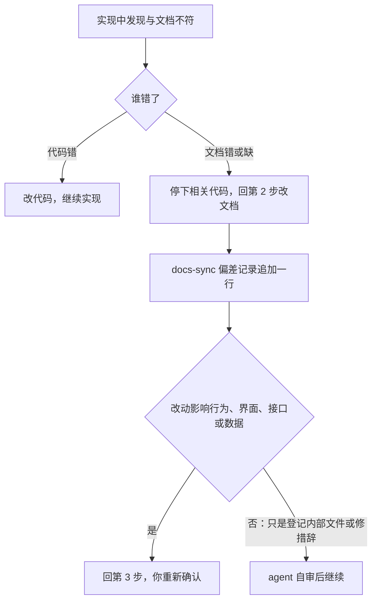

# 01 变更生命周期

> 状态：草稿 | 负责：总编排 | 更新：2026-10-04（rulings §4.25 新建：三档分级、五步、设计质量门、偏差处理、分支与提交、缺陷与发布） | 依赖：charter v0.2；rulings §4.25；[02](02-traceability-and-ownership.md)；[03](03-gates.md)

一项工作 = 一个 OpenSpec 变更，目录 `openspec/changes/<id>/`，工作流 `cordex-docs-first`（proposal → docs-sync → design → tasks）。变更 id 用 kebab-case，按「做什么」命名（`design-language-v3`、`m0-monorepo-skeleton`），不按日期。

## 1. 三档分级

| 档 | 判定 | 开变更 | 评审 | 例 |
|---|---|---|---|---|
| L0 文档修正 | 只改 `docs/`，且不改变任何需求、界面、接口、数据、文件结构、里程碑的含义：错别字、链接与锚点、图的画法、计数句、按已有裁决的机械对齐 | 不开，直接提交文档，过 G7 | 无 | 修 check-links 报的锚点 |
| L1 实现修正 | 改代码或配置，文档描述的行为、界面、接口、数据都不变：修代码使其符合文档、重构、性能、补测试、依赖小版本升级；允许的文档改动只有在 40-modules 对应模块的 §4 目录树与 §5 文件表里登记模块内部新文件 | 开 | agent 自审：docs-sync 写「L1 自审」与理由 | 修一个与文档不符的缺陷 |
| L2 行为变更 | 新增、修改或删除需求、交互、界面、接口、数据结构、错误码、配置键、包与插件、模块边界、依赖准入、里程碑 | 开 | 你确认 | 新功能、改版、裁决回写 |

拿不准一律按 L2。级别写在 proposal.md 的「级别」一行，G2 按它判定要不要你的确认（[03](03-gates.md) §2）。

## 2. 五步

| 步 | 动作 | 进入条件 | 产出 | 谁 |
|---|---|---|---|---|
| 1 提案 | `/opsx:propose`（或 `openspec new change <id>`）；需求不清时先 `/opsx:explore` | 你提出需求，或路线图轮到 | `proposal.md`：Why、What Changes、级别、需求编号、文档影响矩阵、待裁决 | agent 起草；待裁决逐题问你 |
| 2 文档 | 按矩阵回写 `docs/`，顺序：产品 → 设计 → 30 / 40 → 50 / 60 → 70 → `docs/_tools` 登记；界面改动先过设计质量门（§4）；跑全部文档检查 | 待裁决已全部裁决 | `docs/` 改动；`docs-sync.md` 登记每处回写、检查结果与覆盖报告 | agent，可按线分多个 agent 并行，各写各的目录 |
| 3 评审 | agent 给你一页评审摘要（每条线改了什么、对照截图、检查结果、文档站预览）；你确认或要求修改 | 文档检查全过 | `docs-sync.md` 的评审行；L1 写「L1 自审」 | 你（L2）/ agent（L1） |
| 4 实现 | `design.md` 只写文档没覆盖的实现取舍，`tasks.md` 每条任务写依据章节与验证方式；`/opsx:apply` 写代码与测试，代码与测试带 `@req`，新源文件先登记 40-modules 目录树；本地跑门禁 | 评审通过 | 代码、测试；tasks 逐项勾选 | agent |
| 5 归档 | PR 合入 main 后 `/opsx:archive`；有 rulings 小节的写回写状态；重新生成并发布文档站 | CI 全绿、PR 已合入 | 变更移入 `openspec/changes/archive/`；文档站更新 | agent（合并由你决定） |

第 3 步之前不写产品代码（G2）。评审要求修改、或实现中发现文档有误，都回到第 2 步（§5）。

## 3. 提案里必须有的东西

- **级别**：L0 / L1 / L2（§1）。
- **需求编号**：本变更新增、修改、实现或删除的 PRD 需求 id；新增功能先在 PRD 定编号再写其余部分。
- **文档影响矩阵**：五条线加「其他」共 6 行，逐行表态「需更新」或「不涉及：理由」，规则见 [02](02-traceability-and-ownership.md) §4。
- **待裁决**：需要你决定的问题，每题给推荐项与备选、写明影响；未裁决不得进入第 2 步。

## 4. 设计质量门

触发：L2 变更的「设计」行为「需更新」，且涉及界面的布局、交互、视觉或文案层级（只改文案措辞不触发）。

1. **标杆**：为同类界面选 1–2 个标杆产品（默认 Figma Slides；按场景可加 Keynote、Google Slides），参照截图放 `openspec/changes/<id>/benchmarks/`。
2. **样张**：在 playground 新路由或新状态中实现，覆盖默认态与关键状态，亮暗两套；页面不放演示控件，状态全部走 URL 参数，保证截图干净。
3. **对照截图**：Playwright 同视口（1600×1000，2 倍像素）截图，与标杆并排放在 `openspec/changes/<id>/screens/`。
4. **检查清单**（docs-sync 逐项写结论）：

   | # | 检查项 | 通过标准 |
   |---|---|---|
   | Q1 | 内容占比 | 编辑器画布占应用区 ≥ 60%；列表页主内容区 ≥ 70% |
   | Q2 | 入口唯一 | 同一操作在常驻界面上只有一个入口（菜单、右键、快捷键、⌘K 不算重复） |
   | Q3 | 颜色 | 同屏的有彩色只有强调色与内容本身；状态色只在对应状态出现 |
   | Q4 | 形状 | 无药丸按钮（头像、色点除外）、无卡片套卡片；圆角只用设计系统的档位 |
   | Q5 | 材质 | 无渐变背景、光晕、毛玻璃；只有浮层带阴影 |
   | Q6 | 密度与对齐 | 控件高度、节间距、左缘对齐全部一致 |
   | Q7 | 文字 | 无截断、溢出、重叠；中文字号 ≥ 12px |
   | Q8 | 真实内容 | 缩略图、预览、示例数据是真实渲染，不用骨架条 |
   | Q9 | 双主题 | 亮、暗两套都协调，亮色不发灰、暗色不发蓝 |
   | Q10 | token | 只用设计系统 token，不写死颜色、尺寸 |

5. **拍板**：你看对照截图后确认，或指出问题再迭代；拍板写进 docs-sync，之后才回写 `20-design` 文档与其他各线。

检查清单的通过标准以设计系统（[20-design/04](../20-design/04-design-system.md)）为准；`design-language-v3` 归档前按 rulings §4.25 DS-2 的方向执行。

## 5. 偏差处理

**图 1 实现中发现文档不对**

怎么读：先判定谁错。代码错就改代码；文档错或缺，先改文档并记偏差，再看影响面决定要不要重新评审。
依据：rulings §4.25 DP-4。

禁止：按自己的理解写代码、事后补文档；在 `design.md` 或代码注释里另立与文档不同的口径。

## 6. 与 rulings 的关系

- 变更的 proposal 记录本次做什么、为什么、你裁决了什么。
- 裁决满足任一条时，另在 rulings 记一节 §4.N：改章程；覆盖已有 rulings 口径；同一裁决影响 ≥ 3 条线。rulings 小节写变更 id，proposal 写 rulings 小节号。
- 回写清单与进度由变更的 docs-sync 与 tasks 承担，rulings 不再逐行记录回写状态。

## 7. 分支、提交与合入

- 主干 main。一个变更一个分支 `change/<id>`、一个 PR；分支内先提交文档，评审通过后再提交代码。PR 标题 `<id>：<摘要>`，正文首行 `Change: <id>`。
- 提交信息遵循 conventional commits（`docs(<线>): …`、`feat(<包>): …`），末尾加 `Change: <id>`。
- **提交、推送、开 PR、合并都只在你要求时做**；提交前确认无 `debugger`。
- 两个进行中的变更声明了同一个文档文件时，后开的在 proposal 写「依赖：<先开的 id>」，先开的合入后再合（G3 检查）。

## 8. 缺陷、代码评审与发布

- **缺陷**：代码偏离文档 → L1 变更，修代码并补带 `@req` 的回归测试；文档本身有误 → L2 变更，先改文档。
- **代码评审**：每个 PR 由 agent 做一次代码评审，结论贴在 PR 上；CI 全绿且你同意后合并。
- **发布**：M2 之前不发布 npm 包与镜像；之后按 ADR-0002 与 changeset，发布本身作为 L1 变更（`release-<版本>`）。

## 9. 断点续做

- 进度以工作区与 tasks.md 的勾选为准。agent 每完成一项立即勾选、立即写盘；多 agent 并行时按线分文件，互不改同一个文件。
- 中断后先看 `git status` 与 `openspec status --change <id>`，再从未完成处续做，不凭记忆重做。
