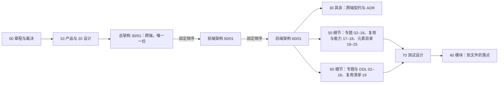

# 文档地图

> 项目：基于 cordis 的可插拔办公文档 SDK 与在线协同编辑器（首个文档类型：PowerPoint / .pptx）
> 阶段：M0 蓝图 | 更新：2026-09-18；2026-09-24（章程 §10 Q1–Q10 已由用户裁决，见 rulings §4.15；单组织、自托管）；2026-09-24（其余 Q11–Q20 已裁决，见 rulings §4.16——章程 §10 全部结案）；2026-09-25（矛盾收口，rulings §4.18）：阅读顺序重编号为 1–8，40-modules 先读 00 再翻 18/19 图集；目录注释改为 playground 为设计基准、补 18/19 图集与文档站/截图/绘图规范工具；2026-09-25（设计线拆分，rulings §4.19）：登记 50-frontend / 60-backend / 70-testing 三条设计线与三线总边界表，阅读顺序改为 1–11（三条设计线排在架构之后、模块设计线之前），目录补三线与 DDL 校验工具；2026-09-26（§4.21：阅读顺序改为「总架构 30/01 → 前端架构 50/01 → 后端架构 60/01 → 各线细节」并补阅读路径图，三线边界表唯一保留于此并按 30/08 撤销、Hocuspocus 与新文档 50/17–25、60/19 改写，目录注释同步）；2026-09-30（§4.22：阅读顺序第 4 条补 §4.22 设计待决收口，三线边界口径链改为 §4.11–§4.22）

## 阅读顺序

1. `00-charter/charter.md` —— 章程 v0.2：定义、硬约束、术语（含 §4.4 架构三件套、可追加元素、元素族、可编辑度）、架构基线（层带与秩表）、已定决策 D1–D16、里程碑、文档树、待用户决策 Q1–Q20（已全部裁决：Q1–Q10 见 rulings §4.15，Q14/Q18 见 §4.12，其余见 §4.16）。**先读这份。**
2. `00-charter/reference-univer-lessons.md` —— 从《Univer 架构评估》提炼的继承/规避清单（下游按编号引用）。
3. `00-charter/cordis-primer.md` —— cordis 4 的 API 摘要与本项目铁律。
4. `00-charter/rulings-2026-09-14.md` —— 对五条线异议/建议的逐条裁决（采纳/否决/待用户），解释 v0.1 → v0.2 的每处变化；§4.15 为章程 §10 Q1–Q10 的用户裁决（2026-09-24：单组织去租户、OIDC/Casdoor、Yjs 撤销语义、DOM/SVG、规模两层口径、保真落点、缩略图、pnpm 11 + Node 26、自托管洁净栈），§4.16/§4.17 为其余待决与复核裁决，§4.18 为文档矛盾收口裁决（2026-09-25：15 项决策、23 项默认值、67 项机械修正），§4.19 为三条设计线拆分与 5 项用户裁决（D-M2-CONTENT 协同后端提前到 M2、INC-09、C-06、D-COMMENTS-PKG、D-TEST-INFRA；其余 76 项遗留口径见 `_evidence/design-tracks-plan-2026-09-25.json`），§4.20 为遗留小项收口，§4.21 为复用优先、架构三件套与编辑器元素的 23 题裁决（2026-09-26：总架构 + 前端架构 + 后端架构、许可分级、协同改用 Hocuspocus 4、M1 上 Nest 12、XML 自研并抽出 `@cordexjs/xml`、表格与图表路线、可追加元素范围），调研证据包在 `00-charter/_evidence/`；§4.22 为设计待决收口（2026-09-30：插入时填入空占位符、占位符表格图标弹网格、放宽插入表格对话框行数）。
   下游文档状态头标注「依赖：charter v0.1」者，均已按裁决做了针对性修订；v0.2 与 v0.1 兼容（只增不改语义）。
5. `10-prd/` —— 产品需求（背景、角色、功能域、非功能、里程碑、指标）。
6. `20-design/` —— 设计（信息架构、流程、29 份界面规格、设计系统、协同 UX、扩展 UX、可访问性、原型自审与 v2 规划、高保真设计稿、设计 playground）。
   - **设计 playground**（`20-design/playground/`，shadcn/ui + Tailwind 实现的真实组件页面，2026-09-15 起唯一设计基准；第 21 版 2026-09-17：shadcn Rhea 风格 + Liquid Glass 材质层，应用首页 + 样式指南 + 17 条界面路由（共 19 条 hash 路由，全部 ready，登记表 `20-design/playground/src/routes/registry.ts`）亮/暗）：https://claude.ai/code/artifact/cf6e1a1a-986b-48bb-b743-5758dff419d2
   - **现代化改造（2026-09-16，已按路线 B 实施）**：审计 `20-design/10-modernization-audit.md`、提案 `20-design/11-modern-glass-redesign-proposal.md`；可点击样张（Rhea + 玻璃）：https://claude.ai/code/artifact/b6766867-9da7-4198-9ec4-fb05f43a7c76 ；三栏对比画廊：https://claude.ai/code/artifact/9d47af4e-3520-48bd-a6e9-f10dbd485e65
   - **编辑器族评审截图**（2026-09-16，108 张，宿主外壳内）：https://claude.ai/code/artifact/f8169a76-10d3-4440-9051-afea486adecf ；评审文档 `20-design/12-editor-routes-review.md`
   - 历史静态稿目录（`20-design/mockups/`，13 稿含母版视图，已被 playground 取代）：https://claude.ai/code/artifact/f4ed564b-f919-473e-9a1b-01644267366a
   - 可点击原型（`20-design/prototype/index.html`）**已退役**：交互基准以 playground 的 19 条路由为准；历史链接：https://claude.ai/code/artifact/a834469c-a2ea-46a8-8dad-28615c015803
   历史静态稿与原型本地直接打开亦可。
7. **架构三件套**（rulings §4.21 q-arch-reorg）——按固定顺序读三份架构，再进各线细节：
   1. `30-architecture/01-overview.md` —— **总架构**，全仓唯一一份、跨端：系统上下文与容器、统一原则、技术栈与复用总表、端到端数据流、M1–M4 里程碑边界唯一表。
   2. `50-frontend/01-overview-and-runtime-map.md` —— **前端架构**（就地升格，节号不动）：浏览器侧执行上下文与层带、前端铁律、运行时对象关系、编辑器能力地图、四条端到端主干。
   3. `60-backend/01-service-overview-and-roles.md` —— **后端架构**（就地升格，节号不动；吸收原 30/08 的后端一页总览）：服务总览、`CORDEX_ROLE` 装配矩阵、Nest 模块与 cordis 宿主、启动与停机。
8. `30-architecture/` 其余 —— 跨端契约与全部 ADR：分层与依赖规则（02）、内核与插件模型（03）、文档模型（04）、命令与历史（05）、协同协议与语义（06）、渲染跨端契约（07）、类型治理（09）、错误码与观测命名（10）、测试策略摘要（11）、多文档类型扩展（12）、ADR。2026-09-25 起运行侧细节改为摘要 + 链接到三条设计线；2026-09-26 起 30/08 撤销（原则并入 30/01，后端总览迁 60/01），30/07 缩为渲染跨端契约。
9. `50-frontend/` —— 前端架构与设计的其余篇（rulings §4.19、§4.21，浏览器侧设计的唯一事实源）：
   - 专题设计 02–16：应用壳路由与会话、preset 装配、命令与撤销的 UI 表达、渲染与缩略图、文本编辑与 IME、协同客户端、评论与版本历史、UI 体系、编辑器外壳、母版版式主题、查看器与 `/render` 页、性能与分包、客户端安全、事件与遥测、i18n 与可访问性；
   - 复用与能力 17–18：前端复用组件清单（用了哪些成熟组件、许可、替代了什么、哪些维持自研及理由）、编辑器能力实现总表（每项能力 → 命令 → 渲染器 → UI 入口）；
   - 元素目录 19–25：可追加元素目录·总览与通用设计（19），再按元素族分篇——文本类、结构类、形状与线条、媒体类、表格与图表、只读与不透明类（20–25），逐元素写「追加什么、有什么作用、怎么设计」。
   先读 `README.md`。
10. `60-backend/` —— 后端架构与设计的其余篇（服务端设计的唯一事实源）：鉴权链、五组模块设计、**完整 DDL**（约定、角色、RLS、迁移编号与 17 张表，可在 PG 18 中顺序执行）、Valkey 与对象存储保留、REST 路由总表、WS 服务端视角（Hocuspocus 钩子挂点）、部署与配置、观测与运维端点（02–18），以及后端复用组件清单（19）。先读 `README.md`，DDL 从 `08` 读起。
11. `70-testing/` —— 测试设计线（2026-09-25）：测试设计的唯一事实源——分层与落点、契约套件与可插拔证据、保真往返与语料、视觉 oracle、协同模拟、前端 / 后端 / 部署 e2e、性能与容量、安全测试、确定性夹具、CI 门禁映射、需求追溯（README + 13 份）。先读 `README.md`、`01` 与 `12`。
12. `40-modules/` —— 模块设计线（2026-09-18）：按 DDD 限界上下文 × cordis 插件切分的 13 个模块，每份细到目录树与逐文件职责；先读 `00-module-map.md`，再翻 `18`/`19` 两份架构图集建立全景，然后按 `40-modules/README.md` 的阅读顺序读（`_template` 模板、14 跨模块评审、16 插件总账、17 书写模式、15 服务端评审，最后按批次读 01–13）。实现到文件时以本目录为准，行为与测试以 50/60/70 为准。

**图 1 阅读路径：章程 → 架构三件套 → 各线细节**



怎么读：先读章程与裁决、再看产品与设计，然后按固定顺序读架构三件套（总架构 → 前端架构 → 后端架构）；三件套读完再分头进入各线细节，最后到测试与模块设计线查落点。箭头是推荐的阅读先后，不是依赖关系。
依据：rulings §4.21 q-arch-reorg；章程 §4.4「架构三件套」。

## 三线边界（rulings §4.19、§4.21；三线边界表只在这里保留一份）

口径链：rulings（§4.11–§4.22，后者覆盖前者）> charter > 已接受 ADR > `30-architecture` > `50-frontend` / `60-backend` / `70-testing`（各管一侧，互不覆盖）> `40-modules` > PRD / 设计既定口径。交互外观以 `20-design` 与 playground 为准，行为语义与状态机以 50 为准；验收阈值与检查名以 PRD 为准，测试怎么执行以 70 为准。架构文档分三件套：总架构 `30-architecture/01`、前端架构 `50-frontend/01`、后端架构 `60-backend/01`（§4.21）。

| 主题 | 唯一事实源 | `30-architecture` 保留 | `40-modules` 保留 |
|---|---|---|---|
| 前端：前端架构（50/01）、应用壳与路由、会话、preset 装配、渲染与缩略图、文本编辑、协同客户端（`@hocuspocus/provider` 胶水）、评论客户端、UI 与主题、性能与分包、客户端安全、事件与遥测、i18n 与无障碍、前端复用组件清单、编辑器能力总表、可追加元素目录 | `50-frontend/` | 总架构（统一原则、技术栈与复用总表、端到端数据流、里程碑边界）、分层与依赖、iso 契约本体（DocumentStore、SceneProvider、TextMeasurer、RenderTarget、OfflineStore 等）、命令与撤销契约、渲染跨端契约 | 前端包的目录树、逐文件职责、cordis 插件定义表、接口签名、测试文件清单 |
| 后端：后端架构（60/01，含原 30/08 的一页总览）、Nest 模块与角色矩阵、鉴权链、Hocuspocus 钩子与扩展挂点、完整 DDL 与 RLS、Valkey 与对象存储、保留期、REST 路由总表、WS 服务端处理、部署配置、观测端点、后端复用组件清单 | `60-backend/` | 五条跨端原则（并入 30/01 统一原则）、WS 协议定义（Hocuspocus 帧 + Stateless 载荷、ack、关闭码，ADR-0039）、错误码格式 / 域清单 / HTTP-WS 映射 | `apps/server` 与 `server-*` 的目录树、文件职责、server-* 插件行、测试文件清单 |
| 测试：分层与落点、契约套件、保真往返与语料、视觉 oracle、协同模拟、e2e、性能与容量、安全测试、夹具与确定性、CI 步骤映射、需求追溯 | `70-testing/` | 测试原则与门禁口径摘要；`09-type-discipline` 的扫描器、lint 与 13 个 CI job 名封闭集合 | 各包 §9 测试文件清单（场景与断言引用 70） |

全部 ADR 仍在 `30-architecture/adr/`，是跨端决策；三条设计线只落实，不改决策。

## 目录

```
docs/
├── README.md
├── 00-charter/          共同输入（总编排；_evidence/ 为裁决调研证据包）
├── 10-prd/              产品条线
├── 20-design/           设计条线（playground/ 为设计基准；prototype/、mockups/ 已退役）
├── 30-architecture/     总架构（01）与跨端契约：结构 / 运行时 / 类型治理（09-type-discipline/）+ adr/；08 已撤销（§4.21）
├── 50-frontend/         前端架构与设计（rulings §4.19、§4.21）：01 前端架构、02–16 专题设计、17–18 复用与能力、19–25 元素目录（README + 01–25）
├── 60-backend/          后端架构与设计：01 后端架构、02–18 专题与完整 DDL、19 复用清单（README + 01–19）
├── 70-testing/          测试设计线：测试设计唯一事实源（README + 01–13）
├── 40-modules/          模块设计线：DDD 限界上下文 × cordis 插件（00 总图 / _template / 01–13 模块 / 14 跨模块评审 / 15 服务端评审 / 16 插件总账 / 17 书写模式 / 18、19 架构图集 / README）
└── _tools/              文档线工具：模块文档结构校验、Mermaid 校验（含绘图规范）、扫描器名校验、DDL 校验（ddl-check.sh）、链接与章节引用检查（check-links.py）、术语残留检查（check-terms.py + terms.json）、文档站生成器（gen-docs-site.py）与界面截图（capture-screens.cjs）、换机器迁移手册（MIGRATION.md）
```

## 状态约定

- 每个文档首行状态头：`> 状态：草稿 | 负责：<条线> | 更新：YYYY-MM-DD | 依赖：charter vX.Y`
- 状态取值：`草稿` → `评审中` → `已批准` → `已过时`
- 与章程冲突：不得擅改章程，写入本条线 README「对章程的异议/建议」
- 未决事项：写入本条线 README「待决事项」并标注决策人
- 图：Mermaid 11，改图后须通过 `_tools/mermaid-check.cjs`（0 invalid）；界面 ASCII 线框、目录树与代码结构仍用文本块（章程 §9.2 第 4 条；画法见 `_tools/README.md`「绘图规范」）

## 与 OpenSpec 的关系

本目录是长期有效的产品/设计/架构基线。具体的实现变更通过 `openspec/changes/<name>/`（proposal / design / specs / tasks）推进，并引用本目录中的文档。M0 结束时建议创建首个 change（如 `bootstrap-monorepo-and-gates`）把「目录骨架 + 全部门禁」落地。
